<div align="center">

<a href="https://recontowers.com/projects/"></a>

<br>

[](CHANGELOG.md)
[](https://github.com/neogentrics/rt-author-desk/actions/workflows/ci.yml)
[](#download)
[](#how-your-library-is-kept)

**[Download](#download)** &nbsp;·&nbsp; **[What it does](#what-it-does)** &nbsp;·&nbsp; **[Roadmap](ROADMAP.md)** &nbsp;·&nbsp; **[What's new](CHANGELOG.md)** &nbsp;·&nbsp; **[Project page](https://recontowers.com/projects/)**

</div>

<br>

The business side of being an author, on your own computer: your books, editions, ISBNs, prices and store listings today,
then sales reports, royalties, accounts, launches and costs. For Windows, Mac and Linux, with no account, no ads and
nothing else to install.

RT Author Desk is part of the **Recon Towers** suite, built by its Dev Department. It was inspired by the owner writing his
own books.

> **Version 1.2 is out.** The catalog (1.0): books, editions, ISBNs, store listings, audiobooks and clashes, with backups, a Trash, and a way to get everything
> out. And the first of the money: KDP sales reports, royalties, and a calculator with rate cards of your own, marked "early" in the menu until they have been
> checked against real reports from every store. Version 1.2 adds Match your columns, for reading a report from a store the app has no reader for yet, and
> the Desk now says which store's next report is ready to download.

<table>
<tr>
<td width="50%">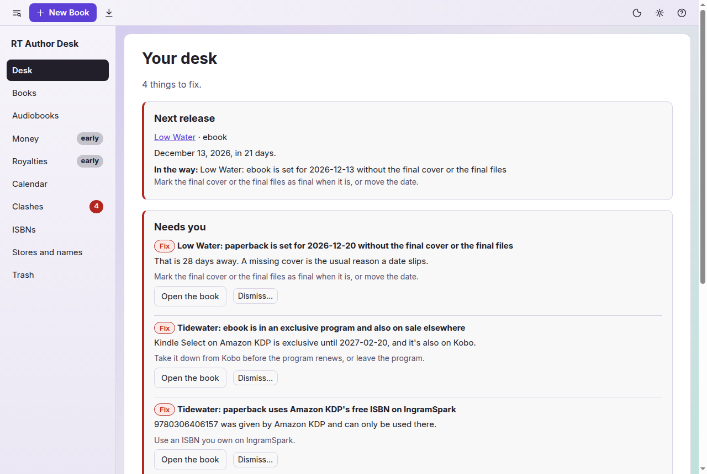<br><b>The Desk.</b> What needs you today: the next release and what is in its way.</td>
<td width="50%">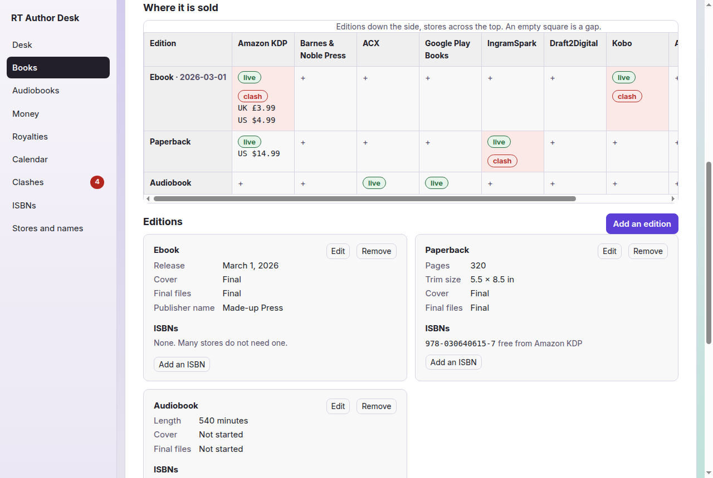<br><b>The store grid.</b> Editions down the side, stores across the top. A gap or a clash shows at a glance.</td>
</tr>
<tr>
<td>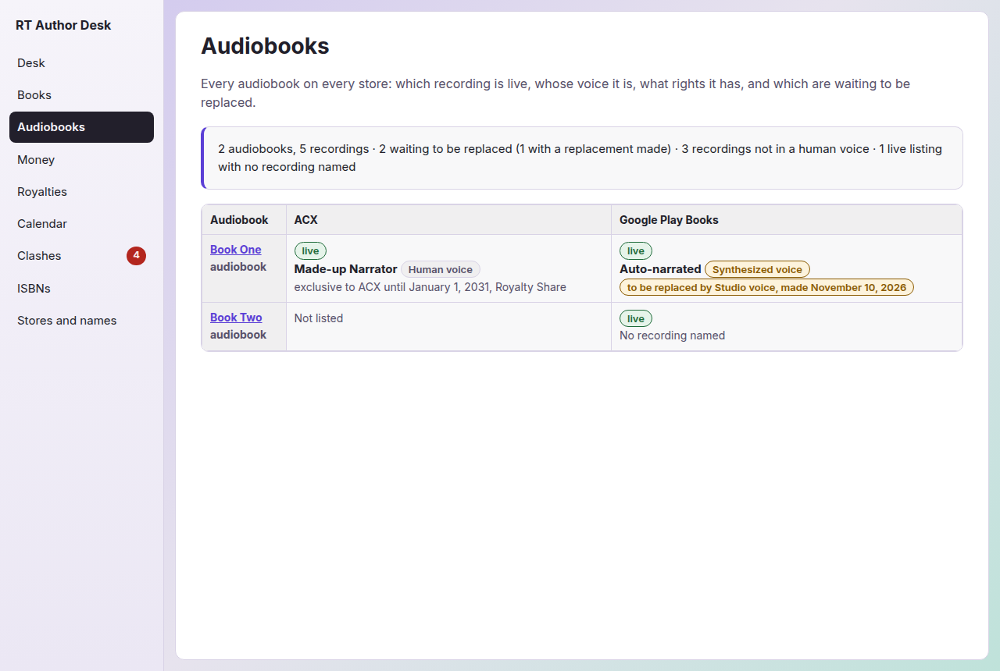<br><b>Audiobooks.</b> Which recording is live where, whose voice it is, and what is waiting to be replaced.</td>
<td>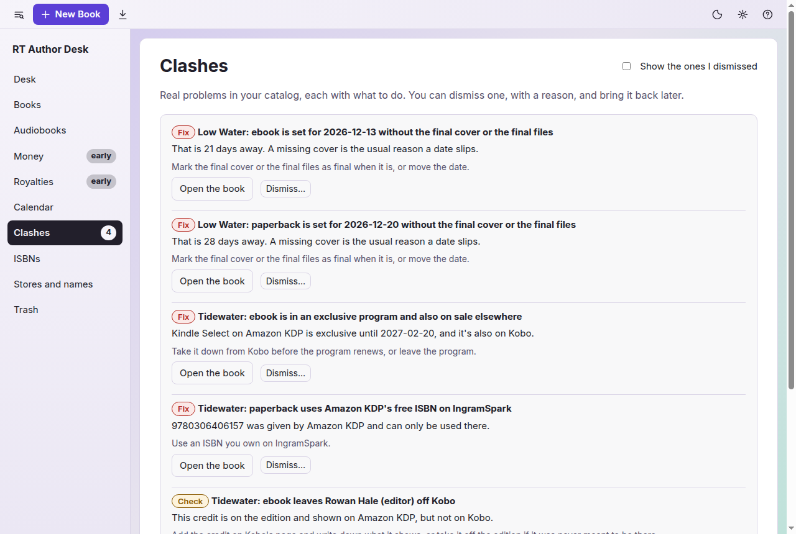<br><b>Clashes.</b> Real problems, each with what to do. Dismiss one with a reason, and bring it back later.</td>
</tr>
<tr>
<td><br><b>Release calendar.</b> Every dated release, by edition and by store.</td>
<td>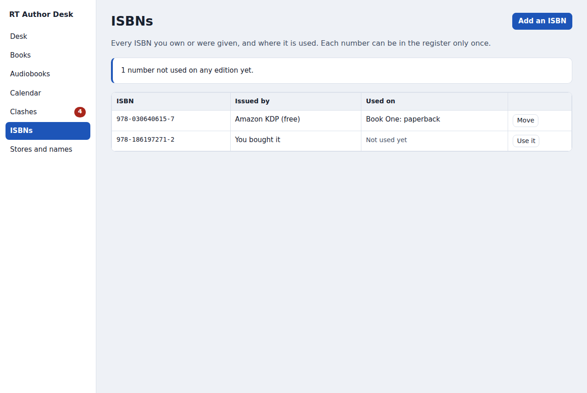<br><b>ISBNs.</b> Every number you own or were given, and where it is used.</td>
</tr>
<tr>
<td>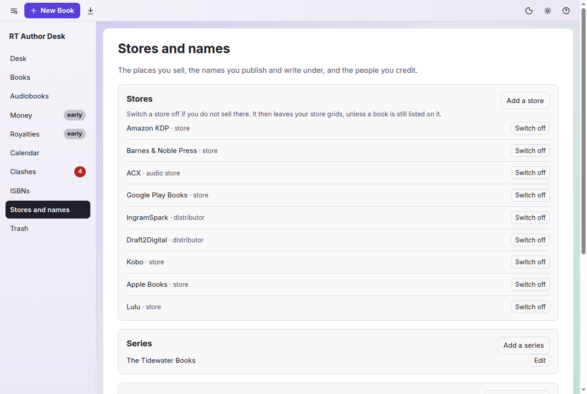<br><b>Stores and names.</b> The places you sell, and the names you publish and write under.</td>
<td>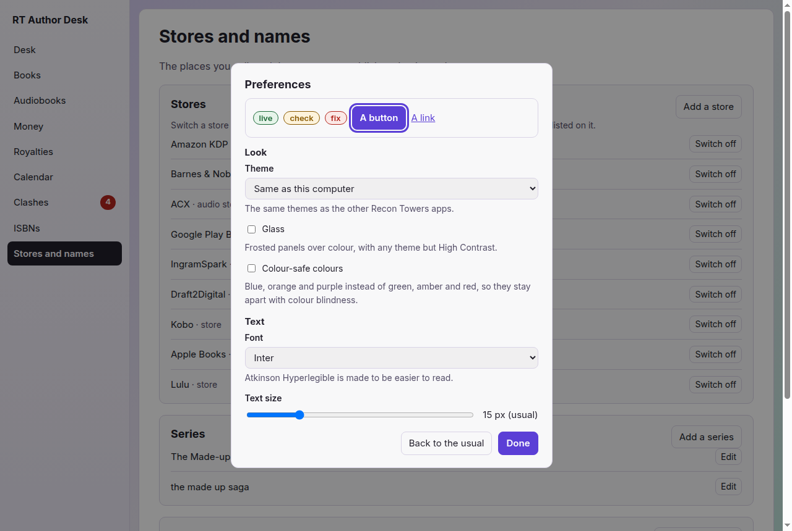<br><b>Make it yours.</b> The suite's themes, Glass, colour-safe colours, fonts and text size.</td>
</tr>
<tr>
<td>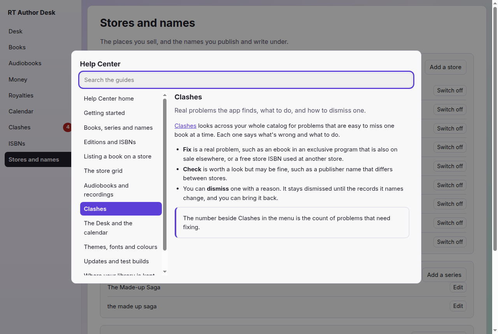<br><b>Help.</b> Short, searchable guides, and a tour of a made-up catalog.</td>
<td>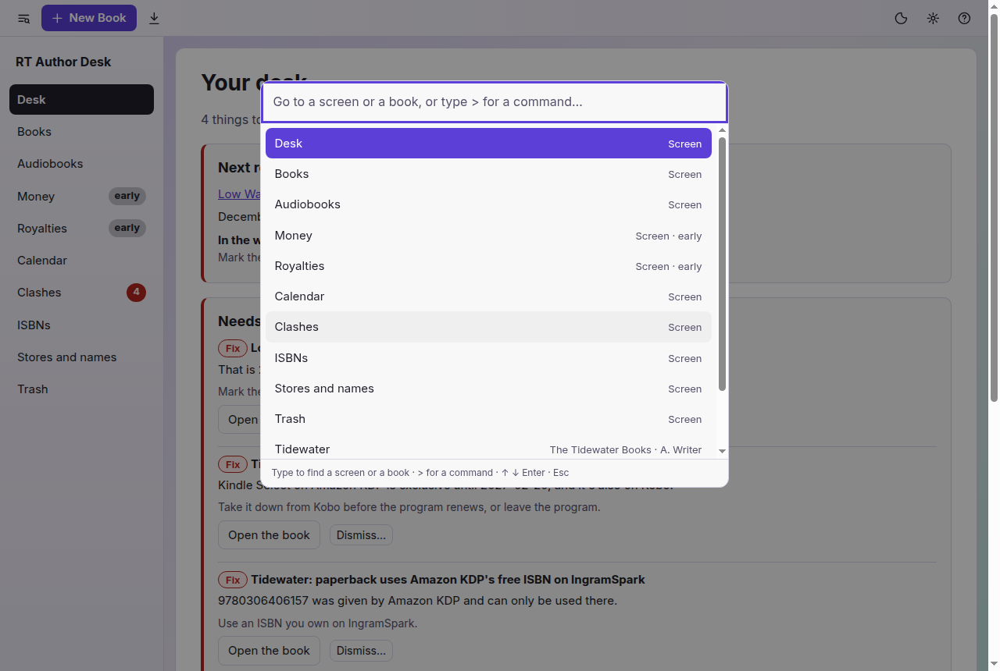<br><b>Go to.</b> <code>Ctrl+K</code> finds a screen or a book. Start with <code>&gt;</code> to run any command by name.</td>
</tr>
<tr>
<td>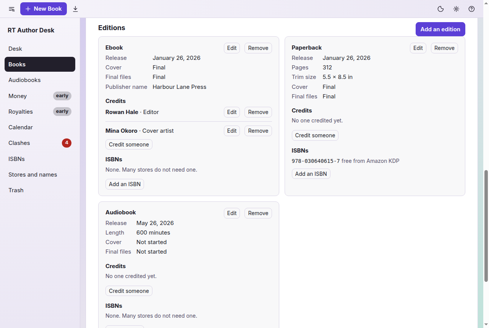<br><b>Credits.</b> Editors, cover artists and narrators on each edition, and which credits each store shows.</td>
<td>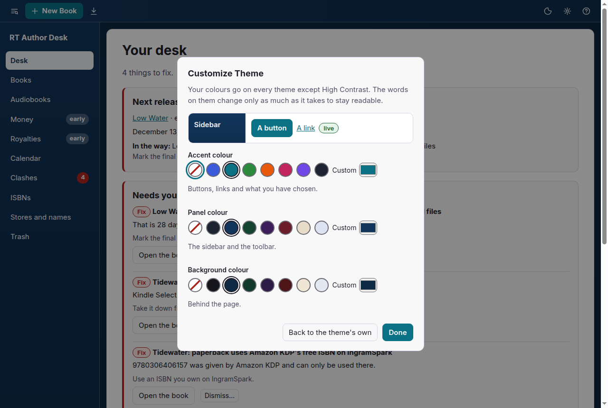<br><b>Your own colours.</b> Pick an accent, panel and background. The words on them stay readable.</td>
</tr>
</table>

*The screenshots show a made-up library.*

## Download

| Windows | macOS | Linux |
|---|---|---|
| `.exe` installer, or a portable `.exe` | `.dmg` for Apple silicon or Intel | `AppImage` or `.deb` |

Version 1.2.0 is on the [Releases](https://github.com/neogentrics/rt-author-desk/releases/latest) page. Every change is built and
checked on all three systems by [CI](https://github.com/neogentrics/rt-author-desk/actions/workflows/ci.yml), which also installs
each build and runs a self-test.

The builds aren't code-signed yet, so Windows may show a SmartScreen warning the first time (choose *More info*, then *Run
anyway*), and macOS will ask you to open the app from *System Settings → Privacy & Security*.

## What it does

| | |
|---|---|
| **Books and series** | Under any number of pen names and publisher names. A book can be planned, in progress, live, pulled or being reworked |
| **Editions** | Ebook, paperback, hardcover, large print and audiobook, each with its own details and release date |
| **ISBNs** | Every number you own or were given, with its check digit verified, who issued it, and which edition uses it. Each number is in the register once |
| **Store listings** | An edition on a store, directly or through a distributor, with its link, status and dated prices in each marketplace. Nine stores come built in, and you can add your own |
| **The store grid** | One page per book: editions down the side, stores across the top |
| **Audiobooks** | Each recording's voice (human, synthesized or cloned), who read it, an exclusive deal and when it ends, and which recordings are waiting to be replaced |
| **The audiobook tracker** | Every audiobook on every store, with the live recording, its voice and its rights |
| **People and credits** | Editors, cover artists, narrators and others, credited on each edition. Write down which credits each store shows, and a store that leaves someone off is pointed out |
| **Clash checks** | Eleven kinds of real problem, such as an ebook in an exclusive program that is also on sale elsewhere, a free store ISBN used at another store, or an editor credited on one store and left off another. Each can be dismissed with a reason |
| **The release calendar** | Every dated release, soonest first |
| **The Desk** | The home screen: the next release and what is in its way, everything that needs you, and which store's next report is ready to download |
| **Sales reports** (early, part of 1.1) | Choose an Amazon KDP orders or payments report and see what it holds before accepting it. Every row is accounted for, rows you already have are skipped, rows that match no book are asked about once, and a whole import can be undone. The original file is kept inside your library |
| **Earned and paid** (early, part of 1.1) | What the reports say you earned, beside what the payment reports say you were paid, by currency and month. A report whose own total doesn't match its rows is flagged and never hidden |
| **Royalties** (early, part of 1.1) | Added up by month, book, edition, store and marketplace, in any mix, always by currency. Estimates from the sales reports are kept apart from what the payment reports say was paid, and last month's earnings show on the Desk |
| **Lulu's sales report** (early, built after 1.2.0 and not yet in a release) | Built from Lulu's own description of the report, and **still to be confirmed on a real file**. Only your own payee's lines are saved, a newer download updates sales that have been paid without counting any twice, and paid money is kept apart from Lulu's estimates |
| **Match your columns** (early, part of 1.2) | For a store the app has no reader for: choose its report (CSV or Excel), say which column is the date (or which month the whole report covers), the title, the copies and what you earned, and see every row accounted for before anything is saved. Files saved as UTF-16 or with tabs are read, and Google Play Books' Sales Summary report is recognized by its headings. The columns are kept, so next month's report is read the same way, and a store that renames a column is told apart from one that did not, with the column named |
| **Calculator** (early, part of 1.1) | What a price earns on each copy at every store that has a rate card, side by side, and the price that earns what you want. A price just under a line says what stepping over it would earn. Every rate says where it came from and whether it was read on the store's own page, and it is an estimate for planning: the store's own report is what counts |
| **Backups, Trash and export** | Backups to a folder you choose, each one file holding the library and its key, so keep it where only you can reach. Anything you remove waits 30 days in the Trash and comes back exactly. Everything can be exported as JSON and CSV, with your original reports |
| **Bring in your books** | From a CSV file, such as a Notion export: match the columns, check what it found, and bring them in. Every row is accounted for, a title you already have is skipped, and the whole import can be undone |
| **Go to** | `Ctrl+K` finds a screen or a book from a few letters, and starting with `>` runs any command from the menus by name, so the menus can stay short |
| **Help and a tour** | A Help Center (`F1`) with short, searchable guides, and a tour of a made-up catalog that never touches your own books |
| **Updates itself** | Looks for a newer version every few hours, test builds included, on Windows and the Linux AppImage. A Mac and the `.deb` are told and sent to the download page. Turn it off in Preferences and the app contacts no one |
| **Make it yours** | Fifteen themes and Follow System, Glass, colour-safe colours, your own accent, panel and background colours, a choice of fonts and text size, from the theme button on every screen and in Preferences (`Ctrl+,`) |
| **For everyone** | Everything can be done from the keyboard, every control has a name for a screen reader, Windows high contrast works, every theme meets WCAG AA contrast, and colour-safe colours keep good news, checks and problems apart with colour blindness. Tests check all of it |
| **Private by default** | Your library is an encrypted database on your own computer. Until a password is set it keeps out a casual look, not someone who can use your account |
| **Works offline** | No account, no server, and nothing you enter is ever sent anywhere. The one thing the app contacts is GitHub, to look for a newer version, and you can turn that off |

Coming next: the rest of the money: readers for Barnes & Noble Press, Google Play Books, Draft2Digital and IngramSpark, built from each store's own
description, and for ACX, Kobo and Apple Books, which are waiting for a real report to build from, two more price checks,
and a check of the readers and the calculator against real reports. Until a store has a reader, Match your columns reads its report. After that: the other stores, costs and profit per book,
launches, accounts and a locked vault for logins, links to the other Recon Towers apps, and moving off Notion. See the
[roadmap](ROADMAP.md).

## What it won't do

- Sign in to a store, or scrape one. Your sales reach it as files you download.
- Post to social media or send email. Other tools do that, and RT Markdown Reader sends documents out.
- Give tax, legal or investment advice. It organizes your numbers.
- Replace bookkeeping software for a business with staff.
- Need AI. That's an add-on, off until you turn it on, with your choice of service, including a model on your own computer.

## How your library is kept

Your whole library is one encrypted database in the app's own folder, with its own random key. With no password set, any copy
of this app can open it, so that's privacy from a casual look, not secrecy. A backup is the library with its key in one file, so it is
only as private as the folder it sits in. Every record has a permanent random ID, changes
are logged, and removals leave a marker for 90 days. The database is upgraded only forward, in numbered steps, and a backup
copy is made before each one. Money is always a whole number of the currency's smallest unit, with its currency code beside
it, never a decimal that can drift. The [data model](docs/design/data-model.md) and
[the vault and your privacy](docs/design/vault-and-privacy.md) say what is kept, what is locked and who can reach what.

## Running it from the source

You need Node.js 22 or newer.

```bash
npm install
```

```bash
npm start
```

```bash
npm test
```

## How the code is laid out

- `src/main`: everything that runs outside the window. `api.js` is the only way the window can ask for anything.
- `src/main/storage`: the only code that touches the library.
- `src/renderer`: the screens, as plain scripts with no inline code.
- `src/shared`: what both sides need, such as money, dates and ISBN checks.

The plan behind it all is in the [product plan](docs/product-plan.md) and the [decisions](docs/decisions.md), with designs for
the [data model](docs/design/data-model.md), [reading sales reports](docs/design/report-imports.md),
[royalties and prices](docs/design/royalties-and-prices.md), [the vault and your privacy](docs/design/vault-and-privacy.md)
and [working with the suite](docs/design/working-with-the-suite.md).

## Contributing and security

Bug reports and ideas are welcome: see [CONTRIBUTING.md](CONTRIBUTING.md) and [SUPPORT.md](SUPPORT.md). To report a security
problem privately, see [SECURITY.md](SECURITY.md).

## Licence

Proprietary, with the source public for reference. See [LICENSE](LICENSE) and
[THIRD_PARTY_NOTICES.md](THIRD_PARTY_NOTICES.md).
