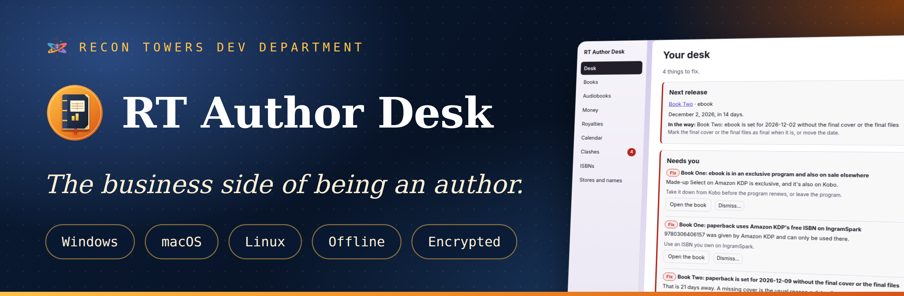
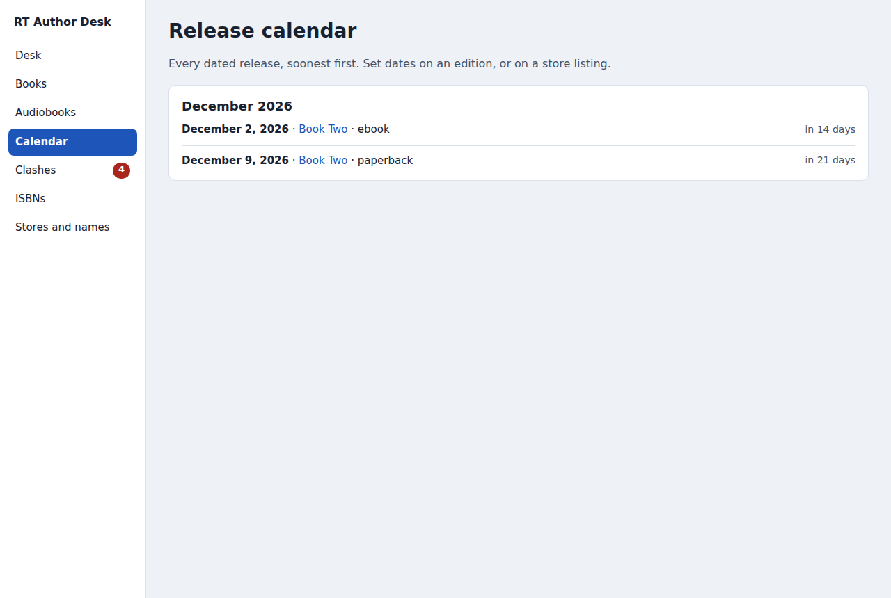

<div align="center">

<a href="https://recontowers.com/projects/"></a>

<br>

[](CHANGELOG.md)
[](https://github.com/neogentrics/rt-author-desk/actions/workflows/ci.yml)
[](#download)
[](#how-your-library-is-kept)

**[Download](#download)** &nbsp;·&nbsp; **[What it does](#what-it-does)** &nbsp;·&nbsp; **[Roadmap](ROADMAP.md)** &nbsp;·&nbsp; **[What's new](CHANGELOG.md)** &nbsp;·&nbsp; **[Project page](https://recontowers.com/projects/)**

</div>

<br>

The business side of being an author, on your own computer: your books, editions, ISBNs, prices and store listings today,
then sales reports, royalties, accounts, launches and costs. For Windows, Mac and Linux, with no account, no ads and
nothing else to install.

RT Author Desk is part of the **Recon Towers** suite, built by its Dev Department. It was inspired by the owner writing his
own books.

> **Status: early build.** The catalog works and is being tested, and Amazon KDP reports can now be imported. Royalties and the calculator are next. There is no
> release to download yet, and until 1.0.0 the builds are test builds, numbered `1.0.0-alpha.1` and so on.

<table>
<tr>
<td width="50%"><br><b>The Desk.</b> What needs you today: the next release and what is in its way.</td>
<td width="50%"><br><b>The store grid.</b> Editions down the side, stores across the top. A gap or a clash shows at a glance.</td>
</tr>
<tr>
<td><br><b>Audiobooks.</b> Which recording is live where, whose voice it is, and what is waiting to be replaced.</td>
<td><br><b>Clashes.</b> Real problems, each with what to do. Dismiss one with a reason, and bring it back later.</td>
</tr>
<tr>
<td><br><b>Release calendar.</b> Every dated release, by edition and by store.</td>
<td><br><b>ISBNs.</b> Every number you own or were given, and where it is used.</td>
</tr>
<tr>
<td><br><b>Stores and names.</b> The places you sell, and the names you publish and write under.</td>
<td></td>
</tr>
</table>

*The screenshots show a made-up library.*

## Download

| Windows | macOS | Linux |
|---|---|---|
| `.exe` installer, or a portable `.exe` | `.dmg` for Apple silicon or Intel | `AppImage` or `.deb` |

Nothing is published yet. The first test build will appear under
[Releases](https://github.com/neogentrics/rt-author-desk/releases). Every change is already built and checked on all three
systems by [CI](https://github.com/neogentrics/rt-author-desk/actions/workflows/ci.yml).

The builds won't be code-signed at first, so Windows may show a SmartScreen warning the first time, and macOS will ask you
to open the app from *System Settings → Privacy & Security*.

## What it does

| | |
|---|---|
| **Books and series** | Under any number of pen names and publisher names. A book can be planned, in progress, live, pulled or being reworked |
| **Editions** | Ebook, paperback, hardcover, large print and audiobook, each with its own details and release date |
| **ISBNs** | Every number you own or were given, with its check digit verified, who issued it, and which edition uses it. Each number is in the register once |
| **Store listings** | An edition on a store, directly or through a distributor, with its link, status and dated prices in each marketplace. Nine stores come built in, and you can add your own |
| **The store grid** | One page per book: editions down the side, stores across the top |
| **Audiobooks** | Each recording's voice (human, synthesized or cloned), who read it, an exclusive deal and when it ends, and which recordings are waiting to be replaced |
| **The audiobook tracker** | Every audiobook on every store, with the live recording, its voice and its rights |
| **Clash checks** | Nine kinds of real problem, such as an ebook in an exclusive program that is also on sale elsewhere, or a free store ISBN used at another store. Each can be dismissed with a reason |
| **The release calendar** | Every dated release, soonest first |
| **The Desk** | The home screen: the next release and what is in its way, and everything that needs you |
| **Sales reports** | Choose an Amazon KDP orders or payments report and see what it holds before accepting it. Every row is accounted for, rows you already have are skipped, rows that match no book are asked about once, and a whole import can be undone. The original file is kept encrypted |
| **Earned and paid** | What the reports say you earned, beside what the payment reports say you were paid, by currency and month. A report whose own total doesn't match its rows is flagged and never hidden |
| **Private by default** | Your library is an encrypted database on your own computer |
| **Works offline** | No account, no server, and nothing leaves your computer |

Coming next: royalties by month, book, edition, store and currency, and a royalty and pricing calculator. Barnes & Noble Press, ACX, Google Play
Books and IngramSpark reports can't be read yet: those readers are waiting for a real report to build from. After that:
costs and profit per book, launches, accounts and a locked vault for logins, links to the other Recon Towers apps, and
moving off Notion. See the [roadmap](ROADMAP.md).

## What it won't do

- Sign in to a store, or scrape one. Your sales reach it as files you download.
- Post to social media or send email. Other tools do that, and RT Markdown Reader sends documents out.
- Give tax, legal or investment advice. It organizes your numbers.
- Replace bookkeeping software for a business with staff.
- Need AI. That's an add-on, off until you turn it on, with your choice of service, including a model on your own computer.

## How your library is kept

Your whole library is one encrypted database in the app's own folder, with its own random key. With no password set, any copy
of this app can open it, so that's privacy from a casual look, not secrecy. Every record has a permanent random ID, changes
are logged, and removals leave a marker for 90 days. The database is upgraded only forward, in numbered steps, and a backup
copy is made before each one. Money is always a whole number of the currency's smallest unit, with its currency code beside
it, never a decimal that can drift. The [data model](docs/design/data-model.md) and
[the vault and your privacy](docs/design/vault-and-privacy.md) say what is kept, what is locked and who can reach what.

## Running it from the source

You need Node.js 22 or newer.

```bash
npm install
```

```bash
npm start
```

```bash
npm test
```

## How the code is laid out

- `src/main`: everything that runs outside the window. `api.js` is the only way the window can ask for anything.
- `src/main/storage`: the only code that touches the library.
- `src/renderer`: the screens, as plain scripts with no inline code.
- `src/shared`: what both sides need, such as money, dates and ISBN checks.

The plan behind it all is in the [product plan](docs/product-plan.md) and the [decisions](docs/decisions.md), with designs for
the [data model](docs/design/data-model.md), [reading sales reports](docs/design/report-imports.md),
[royalties and prices](docs/design/royalties-and-prices.md), [the vault and your privacy](docs/design/vault-and-privacy.md)
and [working with the suite](docs/design/working-with-the-suite.md).

## Contributing and security

Bug reports and ideas are welcome: see [CONTRIBUTING.md](CONTRIBUTING.md) and [SUPPORT.md](SUPPORT.md). To report a security
problem privately, see [SECURITY.md](SECURITY.md).

## Licence

Proprietary, with the source public for reference. See [LICENSE](LICENSE) and
[THIRD_PARTY_NOTICES.md](THIRD_PARTY_NOTICES.md).
