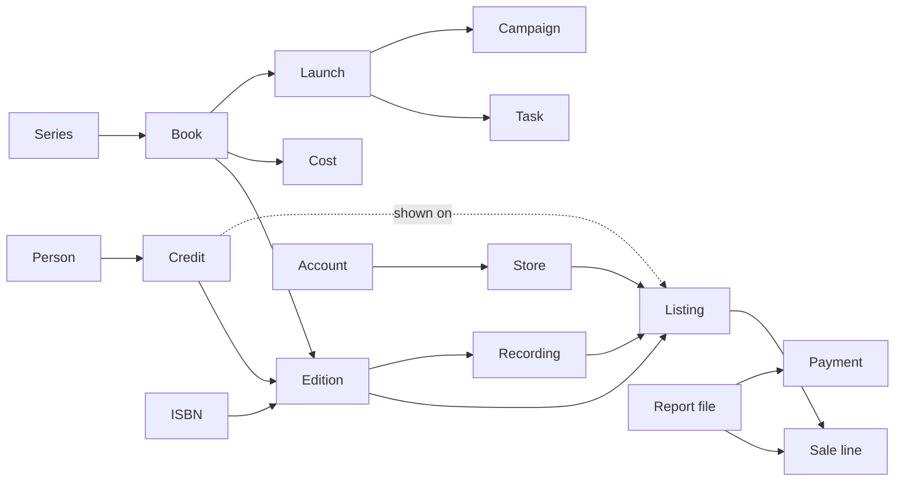

# The data model

The whole app rests on one chain: a **book** has **editions**, and an edition has **listings**. Sales attach to a listing, so
money can be added up by any of them.

## The catalog

| Thing | What it holds |
|---|---|
| **Publisher name** | A name you publish under, with the dates it applied. A name can change, and old listings still show the old one. |
| **Pen name** | A name you write under. |
| **Series** | A name, and the order of its books. |
| **Book** | Title, subtitle, series and number, pen name, and an optional link to the same book in RT Story Tracker. A status for the business side: planned, in progress, live, pulled, being reworked. |
| **Person** | An editor, an artist, a narrator or anyone else you credit. Each is in the list once, by name, so a credit shown differently on two stores can be found by the person. |
| **Credit** | One person in one role on one edition: editor, proofreader, cover artist, illustrator, narrator, translator, formatter or other. The same person can hold two roles on an edition, and the same role can be held by more than one person. |
| **Edition** | One format of a book: ebook, paperback, hardcover, large print or audiobook. Page count, trim size, paper, length, cover status, credits. A book can have several of one format, such as a new paperback after a rework. |
| **ISBN** | The number, who issued it (bought, or a store's free one), where it may be used, and which edition has it. |
| **Recording** | One audio version of a book. See [recordings](#recordings). |
| **Store** | A place that sells or distributes books. Stores are data, so a new one needs no new code. |
| **Listing** | One edition on one store. Store ID, link, status, publisher name shown, the credits it shows (chosen from the edition's own credits, and marked as written down or not), program (such as an exclusive term with start and end dates), and the **route**. |
| **Price** | A listing's price in one marketplace, from a date. Old prices are kept, so a sale can be compared with the price at the time. |

**The route.** Some listings are yours directly, and some reach a store through a distributor. A book at one store can come
from both. The route says which, because reports arrive from the account that pays you, not from the shop the reader used.
Sales are only ever imported from the paying account, so a distributed sale can't be counted twice.

## Recordings

An audiobook edition can exist in more than one version at once: a narrator's recording on one store and a store's auto-made
one on another. So a recording is its own record, and an audiobook listing says which recording is live there.

| Field | What it holds |
|---|---|
| Voice | Human, synthesized, or a cloned voice, which counts as synthesized |
| Read by | The narrator, or the voice and tool that made it, including a store's own auto-narration |
| Permission | For a cloned voice: whose voice it is, and the permission on file |
| Rights | Who holds them, any exclusive deal, which store it's tied to, when it ends, whether it's a royalty share, and the contract attached |
| Replacing | Keep, or waiting to be replaced. If it's waiting, what's replacing it and when it was swapped |
| Made | Length, finished date, and the RT Audio Studio project it came from, if any |

The audiobook tracker reads straight from this: titles down the side, stores across the top, and each square shows the recording,
its voice and any problem. Old recordings stay on record after a swap, so sales can be tied to the recording that made them.

## The money

| Thing | What it holds |
|---|---|
| **Report file** | The original file, its fingerprint, store, period, and what happened to every row. Kept encrypted, so it can be read again if a reader improves. |
| **Sale line** | One row: date, listing, marketplace, type (standard, free, promotion, returned), units, refunds, list and offer price, delivery or print cost, royalty, currency, whether it's an estimate, and where it came from. |
| **Pages read** | Date, listing, marketplace and pages. |
| **Payment** | What a store paid: period, marketplace, accrued amount, tax withheld, adjustments, exchange rate, amount paid and status. |
| **Rate card** | A store's rates and limits for a format, with the date they apply from and where they came from. |
| **Cost** | Date, amount, category, and a book, series or the business, with a receipt attached. |
| **Direct sale** | Date, edition, units, price, how it was paid, and which event or shop. |
| **Stock** | Author copies bought, at what cost, and where they went. |
| **Event** | Date, place, stock taken and brought back, sales and costs. |

### Rules for money

- An amount is a whole number of the currency's smallest unit, with its currency code. There are no floating-point numbers, so
  totals always add up. Currencies with no smaller unit, such as yen, are handled correctly.
- Amounts are never converted when saved. Conversion happens when something is shown, using a rate you can see.
- An **estimate** stays an estimate until a payment covers it. KDP calls its order reports estimated royalties, and its payment
  report is the final word.
- A corrected report replaces the old rows only after you've seen what changes.

## The rest of the business

| Thing | What it holds |
|---|---|
| **Account** | A service: what it's for, login email, account number, plan, cost, renewal date, status, priority. |
| **Checklist item** | A setup job: phase, status, due date, cost, what it's waiting on. |
| **Launch** | A book or edition, a release date, and the template it came from. |
| **Task** | What to do, how long before the release, and whether it's done. |
| **Campaign** | Channel, book, dates, budget, spend and notes. |
| **Listing text** | The master description, keywords and categories, and each store's version. |
| **Audience count** | A channel, a date and a number. |

The vault and personal money are stored apart from all of this. See [the vault and your privacy](vault-and-privacy.md).

## Storage rules

These come from RT Story Tracker and can't be added later.

- One encrypted SQLite database for the library, with a random key.
- Every record has a permanent random ID, so sync can match records between computers.
- A change log records every change, and removals leave a marker for 90 days.
- Room for key slots, for the password and each way back in.
- The live library stays out of synced folders. Backups and sync use closed copies.
- Migrations run forward only, and a test updates a library from every earlier version.

## Getting it out

Everything can leave as CSV and JSON at any time, with a page explaining each file. Original reports leave exactly as they came
in. The vault and personal money have their own exports, which need their own password. This is the promise in the suite page:
there's always a way to get your data out.
